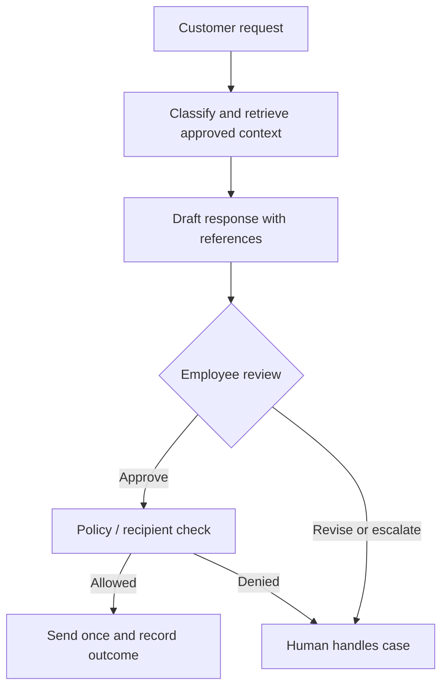

# From AI Tinkerers demos to customer value: an implementation field guide

**Event:** [AI Tinkerers LA — November 20, 2026](https://la.aitinkerers.org/p/ai-tinkerers-la-tinkerers-holiday-party-edition-still-demos)  
**Audience:** Small-business owners, operators, customer support leaders, technical implementers, developers, and curious builders  
**Status:** Independent implementation analysis and **proposed pilots**, not a claim that these customer systems were built or validated at the event.

> **The customer does not buy an agent architecture. The customer wants a useful outcome:** less manual work, faster service, fewer preventable errors, and a system people can understand, approve, and recover when something goes wrong.

This guide translates the [six-presenter event brief](executive-brief.md), [speaker resources](speaker-resources.md), and [edited notes](transcript-notes.md) into testable customer workflows. It extends [the original community event pack (PR #1)](https://github.com/heyitschien/ai-builder-field-notes/pull/1). It does not reproduce private transcripts, client information, private conversations, or unapproved presentation materials.

## 1. What a customer actually needs

A useful AI implementation must answer six questions before selecting a framework:

1. **Problem:** What repeated task or customer frustration are we fixing?
2. **Outcome:** What will improve, and how will we measure it against today's process?
3. **Data and access:** What may the system read, and what must remain private?
4. **Authority:** What may AI recommend, draft, or execute? Which actions require a person?
5. **Reliability:** What happens on missing information, wrong answers, timeouts, duplicate events, and service outages?
6. **Ownership:** Who operates, trains, maintains, and can disable the workflow?

A compelling demo only establishes a possibility. A customer-ready implementation adds testing, permissions, human review, operational documentation, and measurable value.

## 2. Translate all six presentations into possible services

| Event concept | Customer problem it could address | Practical implementation | What to validate before offering it |
| --- | --- | --- | --- |
| **Greg Schoeninger / Oxen.ai — model interoperability** | A team is unsure which AI model is accurate and affordable for its particular workload. | Test the same anonymized support or document task across candidate models behind a stable application interface. | Quality, latency, cost per accepted result, tool compatibility, data handling, and provider availability. [Oxen Hitch](https://github.com/Oxen-AI/OxenHitch) is an experimental desktop integration, **not** a turnkey enterprise orchestration system. |
| **Kraig van der Klomp / MonarchWorks — agent communication** | A request passes through several roles and gets lost, duplicated, or delayed. | Use a controller with explicit task states, event identifiers, worker responsibilities, timeouts, and handoff rules. Add live status updates only when valuable. | No repeated actions; recoverable states; understandable logs; role isolation; bounded retries and stopping rules. [Centrifugo](https://github.com/centrifugal/centrifugo) provides real-time pub/sub, not automatic business-state persistence. |
| **Daniel Ahn / Gallatin AI — agent action security** | Staff want automation but cannot risk unauthorized refunds, account changes, payments, or data disclosure. | Allow AI to propose an action; a separate policy service checks identity, scope, allowlists, limits, and required human approval before any effect. | Negative tests with malicious documents, unauthorized requests, audit trails, credential isolation, and fail-closed behavior. [SweeTrust](https://github.com/sweeai/sweetrust) is a research starting point, not a substitute for security review. |
| **Joshua Laferriere / AI Unified Process — spec-driven development** | A custom tool sounds good but fails because "done" was never defined. | Document user goals, data entities, workflow steps, exceptions, and acceptance checks before AI-assisted coding. | Customer signoff, requirement-to-test coverage, edge cases, maintainability, and handoff. Explore [AI Unified Process](https://github.com/AI-Unified-Process/marketplace) and [GitHub Spec Kit](https://github.com/github/spec-kit). |
| **Sam Wasserman / Imagination Studio — creative workflow integration** | A creative team wastes time moving between storyboards, shots, audio, generation, and editing. | Connect one production pain point, such as approved shot lists flowing to draft visual assets with review and versioning. | Creative control, consistent outputs, file ownership, render failures, hardware costs, confidentiality, and **every model/component's commercial license**. See [Imagination Studio](https://github.com/Keys-Wasserman/Imagination-Studio-by-keys-Wasserman) and [ComfyUI](https://github.com/comfyanonymous/ComfyUI). |
| **Sean McDonald / Timepoint AI — specialized MCP services** | A general chatbot lacks access to a specific approved tool or structured knowledge source. | Integrate a narrow domain tool through [MCP](https://modelcontextprotocol.io/) and surface source references, assumptions, and uncertainty in the result. | Tool permissions, provenance, accuracy, service availability, scenario limitations, and licensing. [Timepoint AI](https://timepointai.com/mcp) simulations are **not verified forecasts or historical facts**. |

**Common pattern:** Keep the human's goal and decision rights stable even if the model, tool vendor, or interface changes.

## 3. Four candidate customer implementations

### A. Customer inquiry and support co-pilot — recommended first pilot

**Who benefits:** A local service business, clinic administration team, retailer, or small B2B support desk handling repetitive requests.

**Current friction:** Requests arrive in multiple places; employees repeatedly look up policies, rewrite standard answers, and track follow-ups manually.

**Proposed workflow:**

1. A form or inbox receives a request; store a request ID and timestamp.
2. AI classifies the question and identifies whether it has the information needed.
3. A read-only connector retrieves approved policies, FAQs, or customer-order context **within that employee's permissions**.
4. AI prepares a proposed answer with references and an uncertainty flag.
5. An employee checks, edits, approves, or escalates it.
6. Only approved messages are sent; the system records status, operator, outcome, and failures.

**Why these event lessons matter:** Joshua defines correct behavior; Greg helps evaluate model choice; Kraig informs state and handoff design; Daniel requires independent authorization; MCP may connect existing systems. **Do not introduce a multi-agent framework or real-time broker unless the simpler design demonstrably needs one.**

**Pilot boundaries:** Use a small set of permitted or synthetic requests. Draft-only by default. No automatic refunds, purchases, credential changes, sensitive disclosures, or unsupervised outbound messaging.

**Useful proof:** Compare time to a correct response, draft acceptance rate, escalation accuracy, error rate, and cost per approved response.

### B. Inventory and purchasing decision support

**Who benefits:** Resale shops, independent retailers, repair operations, or stockroom teams.

**Current friction:** Product information is incomplete, vendor catalogs differ, pricing research is repetitive, and purchasing choices are poorly documented.

**Proposed workflow:** Import approved inventory and supplier data → normalize products and identify missing fields → flag possible matches or anomalies → propose replenishment or price comparisons → employee approves changes → write a traceable update.

**What remains human-controlled:** Vendor choice, purchase authorization, price publication, and exception handling. AI-generated supplier comparisons must cite actual retrieved records, not invented prices.

**Pilot proof:** Records normalized correctly, exceptions found, time per review, incorrect-match rate, and reversibility of changes.

### C. Creative production assistant

**Who benefits:** Small studios, marketing teams, educators, and independent creators.

**Current friction:** Creative direction gets lost between planning, generation, review, editing, and revisions.

**Proposed workflow:** Approved brief → shot or storyboard plan → controlled generation of draft assets → human selection and notes → versioned export to the team's existing editor.

**Pilot proof:** Revision time, continuity issues, usable output percentage, operator control, quality of handoff, and real compute cost. Start with **one bottleneck**, not an end-to-end replacement for a film crew. Check model licenses and permissions before handling client material.

### D. Learning and scenario exploration

**Who benefits:** Teachers, community organizations, and people learning difficult subjects.

**Current friction:** Learners need safe, interactive ways to explore alternatives and receive explanations matched to their level.

**Proposed workflow:** Learner selects a bounded question → specialized tool returns scenarios → assistant explains assumptions and contrasts outcomes → learner checks sources and reflects on choices.

**Pilot proof:** Comprehension, factual accuracy, accessibility, learner engagement, and clarity about simulation versus fact. Do not label speculative scenarios as verified evidence or professional advice.

## 4. One customer pilot from discovery to usable delivery

This is a **repeatable implementation process**, not a prescription to install all six event projects.

| Stage | Operator / customer activity | Deliverable or review gate |
| --- | --- | --- |
| **1. Discover** | Observe the existing workflow and interview the people doing it. | One-page problem statement, present-day baseline, users, scope, and explicit exclusions. |
| **2. Specify** | Agree on examples of normal cases, edge cases, approvals, and failures. | User stories, data map, decision rights, and testable acceptance criteria. |
| **3. Design boundaries** | Decide what is read-only, what is draft-only, and what needs human approval. | Permission matrix; separate credentials; audit fields; data retention and deletion plan. |
| **4. Prototype** | Connect the smallest necessary input, one model or rule set, and a review queue. | Working demo with synthetic or authorized sample data; manual fallback. |
| **5. Evaluate** | Test normal cases, ambiguous inputs, adversarial text, duplicates, API failures, and outage recovery. | Test log with pass/fail results; quality and cost baseline; unresolved limitations. |
| **6. Pilot** | Let a small group operate the tool in parallel with the existing process. | Measured before/after results; operator feedback; explicit go/no-go criteria. |
| **7. Roll out** | Train users and establish owner, support contact, monitoring, and rollback. | Short user guide, FAQ, escalation SOP, change log, and disable switch. |
| **8. Improve** | Review errors and changing business requirements with the customer. | Prioritized fixes and a scheduled review, not indefinite unattended automation. |

### Example customer acceptance criteria for the support pilot

- **AC-01:** Every incoming request receives a unique ID and a visible state.
- **AC-02:** The assistant uses only approved sources and indicates when information is missing.
- **AC-03:** No outbound response is sent until an authorized employee approves the exact content and recipient.
- **AC-04:** A duplicate event or retry cannot send the same response twice.
- **AC-05:** If a model or tool fails, the request stays visible for manual handling; it is not silently discarded.
- **AC-06:** A malicious instruction inside a retrieved document cannot change permissions or trigger an unapproved action.
- **AC-07:** A reviewer can inspect the decision, source references, timestamps, tool calls, and final outcome without exposing unnecessary personal data.
- **AC-08:** The business can pause the integration and continue the original manual process.

A requirements-first process makes these checks reviewable before code is written. Formal skills and tooling are optional for a small pilot; clear requirements and tests are not.

### Illustrative flow

**Control principle:** The model suggests. Business rules and authorized people decide. Durable request state must be persisted separately from a transient message feed.

## 5. Measure outcomes before promising ROI

A pilot should establish a baseline and compare comparable tasks. Example metrics:

| Measure | How to capture it | Why it matters |
| --- | --- | --- |
| **Time per completed request** | Start-to-finish minutes, with and without the pilot | Tests whether work actually gets faster |
| **Accepted draft rate** | Approved drafts / drafts reviewed | Tests usefulness without hiding human correction |
| **Error and escalation rate** | Incorrect answers, unsupported claims, missed handoffs | Tests whether service quality is protected |
| **Unauthorized action attempts blocked** | Simulated negative-test results and execution logs | Tests policy enforcement, not just reassuring prompts |
| **Recovery and duplicate rate** | Interrupted/retried cases with clear final state | Tests operational reliability |
| **Cost per approved outcome** | Model, infrastructure, and operator review cost / approved outcomes | Prevents optimizing API price while increasing human labor |
| **Employee confidence and adoption** | Short interview plus observed use | Tests whether people will actually use the system |

**Do not claim savings, accuracy, enterprise readiness, or a security guarantee until the measurements support them.** Let the customer set thresholds and review the failures, not just averages.

## 6. Customer-facing deliverables, not just source code

A responsible handoff includes:

- A plain-language summary of what the workflow does **and does not do**.
- A diagram of data flow and integration permissions.
- An acceptance checklist with observed test results.
- Operating instructions, troubleshooting steps, and manual fallback.
- Known limitations, security/privacy considerations, and license notices.
- Monitoring, ownership, cost visibility, and a rollback plan.
- A short training session where the actual users complete representative tasks.

An implementer may collaborate with AI coding assistants to build the software, but accountability for architecture, evidence, quality, approvals, and customer understanding remains with the humans delivering and operating it.

## 7. Suggested first experiment

**Goal:** Demonstrate a trustworthy **draft-only customer-support intake assistant**, not a new autonomous business platform.

**Scope:** 30–50 synthetic or appropriately authorized requests, one approved FAQ/data source, one draft queue, one reviewer, simple event logging, and no live sending.

**Demonstration scenarios:**

1. Normal request with a correct source-backed draft.
2. Unknown request escalates instead of inventing an answer.
3. Duplicate delivery does not produce duplicate work.
4. Malicious instruction inside a retrieved document is treated as data, not authority.
5. Simulated service outage leaves the request recoverable.

**Decision gate:** Proceed toward a real customer pilot only if the review evidence shows useful quality, manageable effort, protected decision rights, and a clear owner. Otherwise record the learning and narrow the scope.

**Avoid premature complexity:** Start with a single workflow and deterministic business rules. Introduce multiple agents, a pub/sub layer, alternate model routing, or custom MCP services only when measured requirements justify them.

## 8. Sources, limitations, and further reading

- Event recap: [Executive brief](executive-brief.md) · [Speaker resources](speaker-resources.md) · [Edited transcript notes](transcript-notes.md).
- Requirements and traceability: [AI Unified Process](https://github.com/AI-Unified-Process/marketplace) · [GitHub Spec Kit](https://github.com/github/spec-kit).
- Messaging: [Centrifugo](https://github.com/centrifugal/centrifugo) · [official documentation](https://centrifugal.dev/docs/getting-started/introduction).
- Security experiment: [SweeTrust](https://github.com/sweeai/sweetrust) · independent authorization and human approval remain necessary.
- Creative pipeline: [Imagination Studio](https://github.com/Keys-Wasserman/Imagination-Studio-by-keys-Wasserman) · [ComfyUI](https://github.com/comfyanonymous/ComfyUI).
- Integration and simulation: [official MCP documentation](https://modelcontextprotocol.io/) · [Timepoint MCP](https://timepointai.com/mcp).
- Model access experimentation: [Oxen Hitch](https://github.com/Oxen-AI/OxenHitch).

**Evidence boundary:** The talks and repository links establish the ideas discussed and the existence of public projects. The customer scenarios, process, metrics, and pilot design here are **our proposed interpretation**. None is a confirmed deployment, presenter-endorsed recommendation, audited security control, or measured customer outcome. Verify current licenses, supported features, and data-handling terms before commercial adoption.
